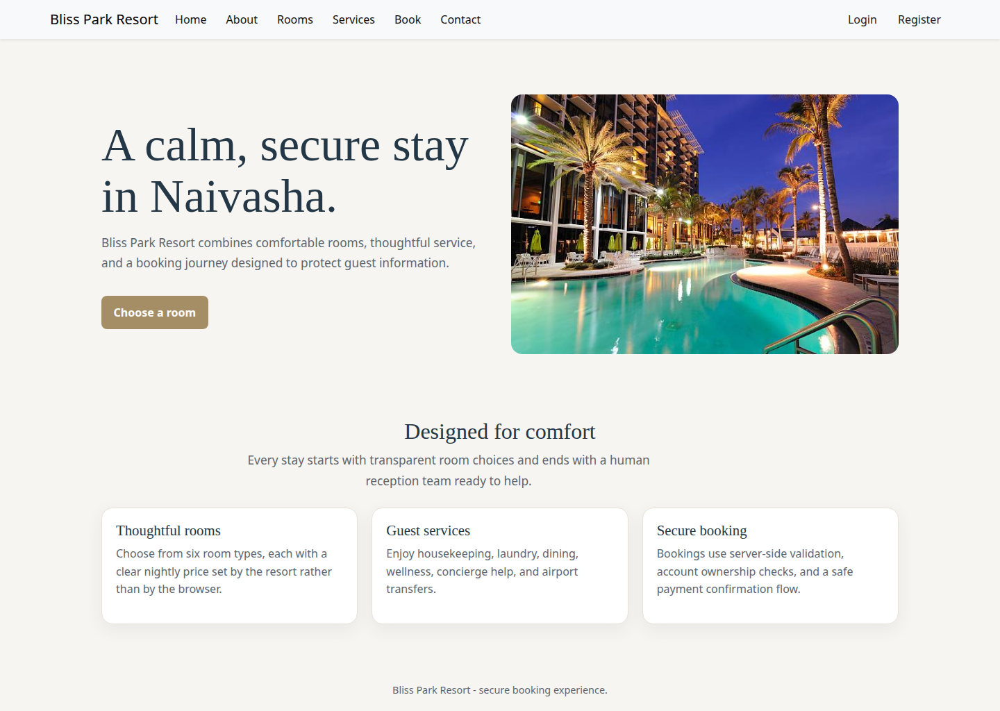

# Bliss Park Resort

A PHP and MariaDB resort booking application built around secure server-side
workflows. It supports guest bookings, reception check-in/check-out, and
administrative room, user, and reporting tasks.



## Highlights

- Role-based guest, receptionist, and administrator workflows
- Server-owned booking prices, date rules, overlap checks, and state changes
- Prepared statements, output encoding, CSRF protection, and ownership checks
- Hardened sessions, generic login errors, rate limiting, and session rotation
- Content Security Policy, browser security headers, least-privilege database access, and structured audit events

## Security design

The application treats browser input as untrusted. Every state-changing request
passes through validation, CSRF verification, role checks, and prepared database
queries before a response is rendered.

| Area | Implementation |
| --- | --- |
| Access control | Server-side role gates and booking queries bound to the signed-in user id |
| Authentication | `password_hash`, `password_verify`, generic failures, rate limiting, and session-id rotation |
| Injection and XSS | Prepared statements, typed validation, and `htmlspecialchars` through `h()` |
| Booking integrity | One transaction, room-row lock, overlap check, and explicit booking states |
| Browser protection | CSP, frame denial, `nosniff`, referrer policy, and a limited permissions policy |
| Logging | Structured audit events with common secret fields filtered before writing |

The project follows the OWASP Top 10 as an engineering review baseline. It is
not a certification, payment gateway, or production deployment.

## Run locally

Requirements: PHP 8.1+ with MySQLi, and MariaDB or MySQL.

1. Create the schema as a database administrator:

   ```bash
   mariadb -u root -p < schema.sql
   ```

2. Create a local application account with a password of your choice:

   ```sql
   CREATE USER 'bliss_app'@'localhost' IDENTIFIED BY 'choose_a_unique_local_password';
   GRANT SELECT, INSERT, UPDATE, DELETE ON bliss_park.* TO 'bliss_app'@'localhost';
   FLUSH PRIVILEGES;
   ```

3. Copy `.env.example` to `.env`, then set `BLISS_DB_PASS` to that same local password.

4. Load synthetic data:

   ```bash
   mariadb -u bliss_app -p bliss_park < demo-seed.sql
   ```

5. Start the local server:

   ```bash
   php -S localhost:8000 router.php
   ```

Open <http://localhost:8000>. The development router mirrors the safe legacy
redirects and prevents local access to `.env`, SQL files, logs, and internal
folders. Use Apache or PHP-FPM for a deployed environment.

## Synthetic demo accounts

| Role | Username | Password |
| --- | --- | --- |
| Administrator | `admin` | `BlissAdmin#2026` |
| Reception | `receptionist` | `FrontDesk#2026` |
| Guest | `demo_guest` | `DemoGuest#2026` |

These accounts and all seed data are synthetic and local-only. Replace them,
set `BLISS_SECURE_COOKIES=1`, and deploy HTTPS before any real use.

## Project structure

- `includes/security.php` - sessions, headers, access checks, validation helpers, database connection, and audit logging
- `includes/booking_rules.php` - transaction-safe booking rules and state validation
- `csrf.php` - CSRF token creation and form helper
- `schema.sql` and `demo-seed.sql` - schema and synthetic local data

## Production considerations

Before a real deployment, use HTTPS and HSTS, unique credentials, a managed
payment provider, backup and recovery procedures, alerting and log retention,
dependency review, and stronger staff authentication where appropriate.

## License

Released under the [MIT License](LICENSE).
